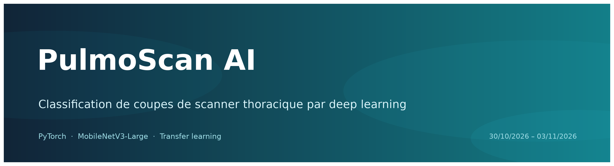
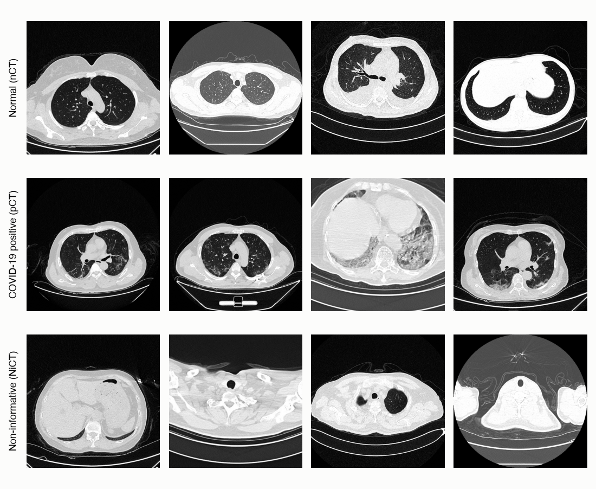
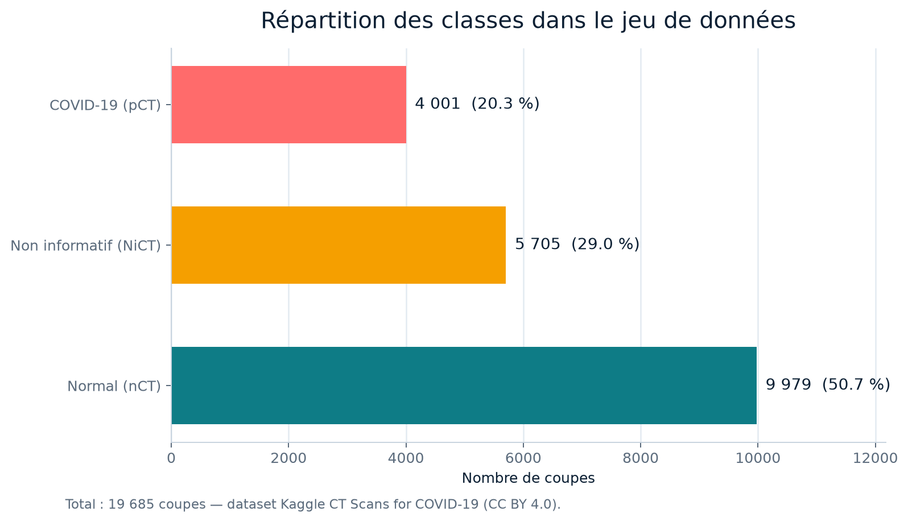
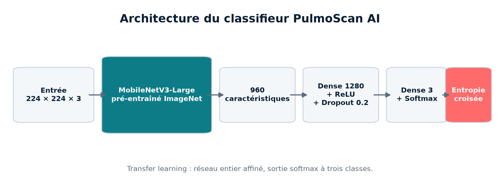
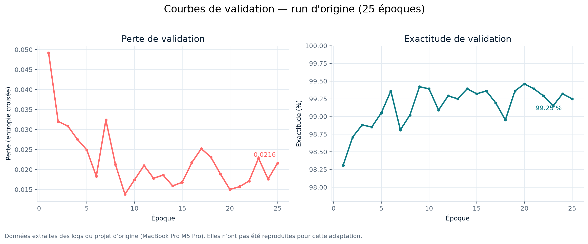
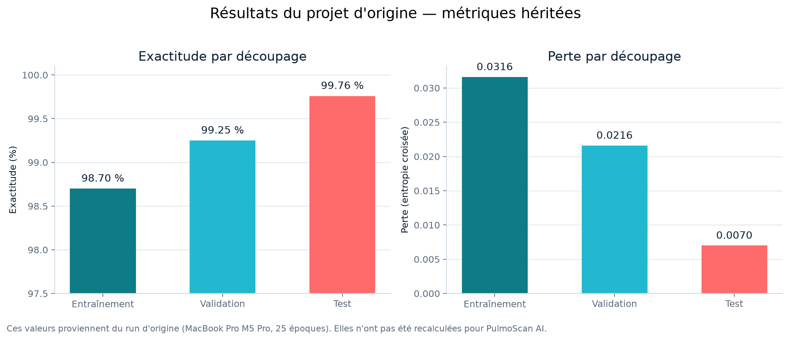
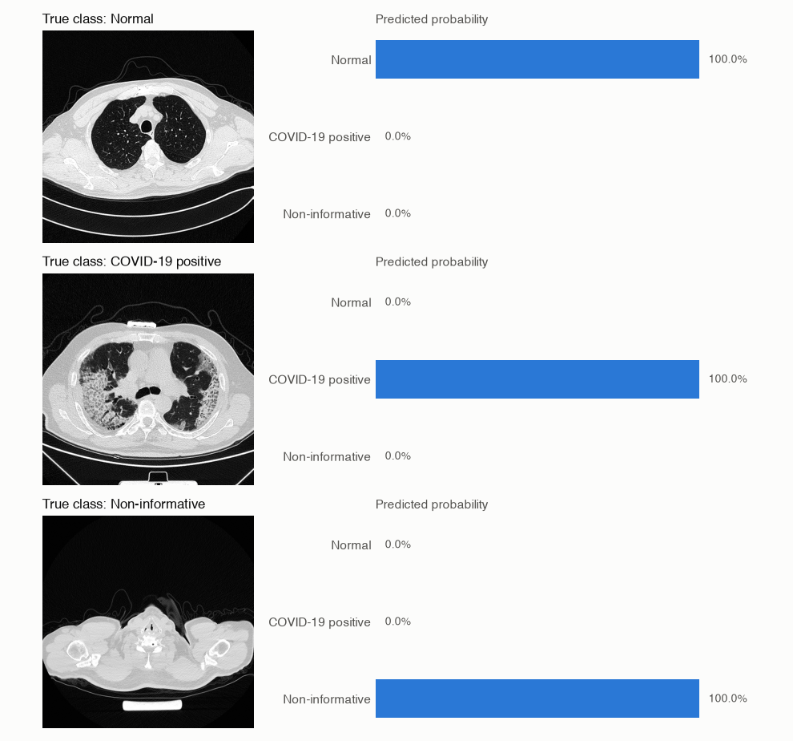

<p align="center">
  
</p>

<h1 align="center">PulmoScan AI</h1>

<p align="center">
  <strong>Classification de coupes de scanner thoracique par deep learning</strong>
</p>

<p align="center">
  
  
  
  
  
</p>

<p align="center">
  <strong>Auteur :</strong> Mohammed Oughlane · Marrakech, Maroc<br>
  <strong>Période de réalisation :</strong> 30/10/2026 – 03/11/2026
</p>

<p align="center">
  <a href="[LIEN_GITHUB]">GitHub</a> ·
  <a href="[LIEN_LINKEDIN]">LinkedIn</a>
</p>

> **Description GitHub :** Classification de coupes de scanner thoracique (normal / COVID-19 / non informatif) avec PyTorch et MobileNetV3, par transfer learning. Projet pédagogique.

## Résumé

PulmoScan AI classe une coupe axiale de scanner thoracique en trois catégories : normal, COVID-19 ou non informatif.
Le modèle s'appuie sur MobileNetV3-Large pré-entraîné sur ImageNet, affiné par transfer learning avec PyTorch.
Ce projet est pédagogique : il documente la démarche, les résultats et les limites du modèle, sans vocation clinique.

## Table des matières

- [Présentation](#présentation)
- [Données](#données)
- [Modèle](#modèle)
- [Entraînement](#entraînement)
- [Résultats](#résultats)
- [Installation](#installation)
- [Utilisation](#utilisation)
- [Analyse critique](#analyse-critique)
- [Ma contribution](#ma-contribution)
- [Crédits et attribution](#crédits-et-attribution)
- [À propos de l'auteur](#à-propos-de-lauteur)
- [Avertissement](#avertissement)

## Présentation

Un scanner thoracique contient des centaines de coupes axiales. Toutes ne montrent pas les poumons : certaines se situent au-dessus ou en dessous de la zone utile, et ne permettent pas de conclure. Un classifieur utile doit donc distinguer trois situations, et pas seulement « normal » contre « malade ».

| Classe | Signification | Effectif |
|---|---|---:|
| `nCT` | Scanner normal. Les poumons sont visibles et ne montrent pas de signe de COVID-19. | 9 979 |
| `pCT` | Scanner positif. Les poumons présentent des anomalies typiques d'une pneumonie à COVID-19. | 4 001 |
| `NiCT` | Scanner non informatif. La coupe ne montre pas assez de poumons pour conclure. | 5 705 |



*Exemples de coupes issues du jeu de données. Figure du projet d'origine.*

L'approche est volontairement simple et reproductible : un réseau convolutif compact, pré-entraîné sur ImageNet, est réentraîné sur les coupes scanner. Le projet ne cherche pas à construire un dispositif médical, mais à montrer une démarche complète de vision par ordinateur : préparation des données, transfer learning, évaluation, analyse des limites et restitution.

Ce dépôt est une adaptation française et une remise en forme du projet open-source [`covid-ct-classifier`]([URL_DU_REPO_ORIGINAL]) par son auteur original. Le code, l'architecture, les poids et les résultats d'origine lui appartiennent ; les crédits sont détaillés plus bas.

## Données

Les images proviennent du jeu de données Kaggle [CT Scans for COVID-19 Classification](https://www.kaggle.com/datasets/azaemon/preprocessed-ct-scans-for-covid19), publié par Abu Zahid Bin Aziz sous licence **CC BY 4.0**. Les images originales sont issues de la ressource [iCTCF](http://ictcf.biocuckoo.cn/) : Ning, W. et al., « iCTCF: an integrative resource of chest computed tomography images and clinical features of patients with COVID-19 pneumonia » (2020).

Le jeu de données contient **19 685 coupes** réparties en trois classes. Le téléchargement propose des coupes originales et une version prétraitée où les poumons sont découpés ; ce projet utilise les coupes originales.



### Découpage

Chaque classe est mélangée avec une graine fixe (`42`), puis découpée en environ 70 % d'entraînement, 15 % de validation et 15 % de test. Les effectifs exacts sont fixés dans le notebook, ce qui rend le découpage identique à chaque exécution. Aucun fichier n'est copié : le découpage est matérialisé par trois listes d'indices.

| Classe | Entraînement | Validation | Test | Total |
|---|---:|---:|---:|---:|
| `nCT` | 6 985 | 1 496 | 1 498 | 9 979 |
| `NiCT` | 3 993 | 855 | 857 | 5 705 |
| `pCT` | 2 800 | 600 | 601 | 4 001 |
| **Total** | **13 778** | **2 951** | **2 956** | **19 685** |

### Transformations

Toutes les images sont redimensionnées et normalisées avec les statistiques ImageNet attendues par le réseau pré-entraîné :

- redimensionnement à 256 px, puis recadrage central en 224 × 224 pour la validation et le test ;
- recadrage aléatoire et retournement horizontal pour l'entraînement ;
- normalisation avec les moyennes `[0.485, 0.456, 0.406]` et les écarts-types `[0.229, 0.224, 0.225]`.

Le découpage est fait **par coupe, pas par patient**. Cette limite est importante et est discutée dans l'[analyse critique](#analyse-critique).

## Modèle



Le backbone est [MobileNetV3-Large](https://arxiv.org/abs/1905.02244), un réseau convolutif compact conçu pour les appareils mobiles et pré-entraîné sur ImageNet. Il transforme chaque image 224 × 224 en un vecteur de 960 caractéristiques. Sa tête d'origine, qui produit 1 000 classes ImageNet, est remplacée par un petit classifieur :

```text
960 caractéristiques → Linear 1 280 → ReLU → Dropout 0.2 → Linear 3 → LogSoftmax
```

| Élément | Valeur |
|---|---|
| Backbone | MobileNetV3-Large, poids ImageNet |
| Entrée | 224 × 224 × 3 |
| Caractéristiques | 960 |
| Tête | Linear 1 280 → ReLU → Dropout 0.2 → Linear 3 → LogSoftmax |
| Paramètres entraînables | 4 205 875 |
| Perte | `NLLLoss` sur sortie log-softmax |
| Fine-tuning | Réseau entier affiné, pas seulement la tête |

L'utilisation de `NLLLoss` avec une sortie log-softmax est équivalente à une entropie croisée classique. Le fine-tuning complet permet au backbone d'adapter ses représentations aux textures et aux structures des coupes scanner, au prix d'un temps d'entraînement plus long.

## Entraînement

Les réglages ci-dessous sont ceux du **projet d'origine**. Ils sont documentés pour permettre de reproduire le run, pas pour revendiquer un nouvel entraînement.

| Réglage | Valeur |
|---|---|
| Optimiseur | AdamW |
| Taux d'apprentissage | `1e-4` |
| Weight decay | `1e-4` |
| Taille de batch | 16 |
| Époques | 25 |
| Précision | float32 |
| Matériel | MacBook Pro M5 Pro, 48 Go, backend PyTorch MPS |
| Durée | 41 min 07 s (25 époques) |

La précision mixte est supportée sur MPS, mais elle était plus lente que le float32 pour ce modèle lors des tests du projet d'origine ; elle est donc désactivée.

> **Transparence :** je n'ai pas réentraîné ce modèle. Les poids inclus dans le dépôt et les métriques présentées proviennent du projet d'origine.

## Résultats

> **Important — résultats hérités.** Les métriques de cette section sont celles du **projet d'origine**. Elles n'ont pas été recalculées par Mohammed Oughlane et ne constituent pas une validation indépendante. Elles sont reproduites pour documenter le modèle et son niveau de performance.

| Découpage | Images | Exactitude | Perte |
|---|---:|---:|---:|
| Entraînement | 13 778 | 98,70 % | 0,0316 |
| Validation | 2 951 | 99,25 % | 0,0216 |
| **Test** | **2 956** | **99,76 %** | **0,0070** |



*Courbes reconstruites à partir des logs du run d'origine. Les valeurs sont héritées, pas recalculées.*



*Métriques du projet d'origine, présentées à titre documentaire.*

L'exactitude de validation dépasse 99 % dès la cinquième époque, puis oscille entre environ 98,8 % et 99,5 %. L'essentiel de l'apprentissage se produit donc tôt. L'exactitude d'entraînement est légèrement inférieure à celle de validation et de test parce qu'elle est mesurée avec les augmentations d'entraînement encore actives (recadrages et retournements aléatoires).

Le projet d'origine compare deux exécutions :

| Métrique | Run Windows (RTX 2060, CUDA) | Run macOS (M5 Pro, MPS) |
|---|---:|---:|
| Exactitude entraînement | 98,58 % | 98,70 % |
| Exactitude validation | 99,42 % | 99,25 % |
| Exactitude test | 99,53 % | 99,76 % |
| Durée, 25 époques | non mesurée | 41 min 07 s |



*Prédictions du modèle d'origine sur une coupe de test par classe. Figure du projet d'origine.*

### Métriques par classe

L'exactitude globale peut masquer une classe mal reconnue, surtout avec un jeu de données déséquilibré. Le notebook contient désormais une cellule qui calcule, sur le jeu de test :

- la matrice de confusion ;
- la précision, le rappel, le F1 et le support pour chaque classe ;
- l'exactitude globale ;
- une figure `assets/confusion-matrix.png` et un fichier `outputs/metrics.json`.

> Ces cellules n'ont pas été exécutées dans l'environnement de préparation, faute de jeu de données local. Elles sont prêtes à l'emploi après téléchargement des images. Aucun résultat par classe n'est inventé dans ce README.

## Installation

### Prérequis

- Python 3.11 ;
- environ 4 Go d'espace disque pour le jeu de données ;
- un GPU Apple Silicon (MPS) ou NVIDIA (CUDA) pour un entraînement rapide ; le CPU fonctionne, mais beaucoup plus lentement ;
- un compte Kaggle gratuit pour télécharger les images.

### Cloner le dépôt

```bash
git clone [URL_DE_MON_REPO]
cd pulmoscan-ai
```

### Environnement Python

```bash
python3.11 -m venv .venv
source .venv/bin/activate        # macOS / Linux
# .venv\Scripts\activate         # Windows PowerShell
pip install -r requirements.txt
```

### Télécharger les données

Créez un jeton API Kaggle dans **Kaggle → Settings → API → Create New Token**, puis :

```bash
mkdir -p ~/.kaggle
mv ~/Downloads/kaggle.json ~/.kaggle/
chmod 600 ~/.kaggle/kaggle.json

kaggle datasets download -d azaemon/preprocessed-ct-scans-for-covid19 \
  -p ~/datasets/covid-ct --unzip
```

Sous Windows PowerShell :

```powershell
New-Item -ItemType Directory -Force "$HOME\.kaggle"
Move-Item "$HOME\Downloads\kaggle.json" "$HOME\.kaggle\kaggle.json"
kaggle datasets download -d azaemon/preprocessed-ct-scans-for-covid19 -p "$HOME\datasets\covid-ct" --unzip
```

Copiez ensuite les dossiers `nCT`, `NiCT` et `pCT` des **coupes originales** dans un dossier `CT Scans` à la racine du projet :

```text
CT Scans/
├── nCT/
├── NiCT/
└── pCT/
```

Le notebook accepte aussi un autre emplacement via la variable d'environnement `PULMOSCAN_DATA_ROOT`.

### Démo Streamlit (optionnelle)

```bash
pip install -r requirements-demo.txt
streamlit run app.py
```

La démo charge le checkpoint inclus et permet de tester une image depuis le navigateur. Elle affiche les probabilités par classe et rappelle les limites du modèle.

### Docker (optionnel)

```bash
docker build -t pulmoscan-ai .
docker run --rm -p 8501:8501 pulmoscan-ai
```

L'application est alors disponible sur `http://localhost:8501`.

### Structure du dépôt

```text
.
├── app.py                                  Démo Streamlit
├── assets/                                 Figures et visuels du README
├── classifier.ipynb                        Notebook : données, entraînement, évaluation, inférence
├── classifier.html                         Export statique du notebook
├── outputs/checkpoints/
│   └── mobilenet_v3_large.pth              Poids entraînés (17 Mo)
├── reports/
│   └── training_history_original_run.json  Logs de validation du run d'origine
├── scripts/
│   └── make_figures.py                     Génération des figures françaises
├── Dockerfile
├── requirements.txt
├── requirements-demo.txt
└── README.md
```

## Utilisation

### Notebook

Ouvrez `classifier.ipynb` dans Jupyter ou VS Code, puis exécutez toutes les cellules. Le notebook vérifie les effectifs, entraîne le modèle, évalue les trois découpages et sauvegarde le checkpoint dans `outputs/checkpoints/mobilenet_v3_large.pth`.

Pour un test rapide, passez `SMOKE_TEST = True` dans la cellule « Paramètres » : le notebook n'exécute qu'une époque, utilise un petit sous-ensemble des données et désactive les workers. C'est utile pour vérifier l'installation avant un run complet.

### Inférence sur une image

```python
import torch
from torch import nn
from torchvision import models, transforms
from PIL import Image

CHECKPOINT = "outputs/checkpoints/mobilenet_v3_large.pth"
CLASS_NAMES = {
    "nCT": "Scanner normal",
    "NiCT": "Scanner non informatif",
    "pCT": "Scanner positif à la COVID-19",
}


class Classifier(nn.Module):
    def __init__(self, input_size=960, output_size=3, hidden_layers=(1280,), drop_p=0.2):
        super().__init__()
        layers = []
        prev = input_size
        for hidden in hidden_layers:
            layers += [nn.Linear(prev, hidden), nn.ReLU(inplace=True), nn.Dropout(drop_p)]
            prev = hidden
        layers.append(nn.Linear(prev, output_size))
        self.net = nn.Sequential(*layers)

    def forward(self, x):
        return torch.log_softmax(self.net(x), dim=1)


ckpt = torch.load(CHECKPOINT, map_location="cpu", weights_only=False)

model = models.mobilenet_v3_large(weights=None)
model.classifier = Classifier(
    input_size=ckpt["input_size"],
    output_size=ckpt["output_size"],
    hidden_layers=ckpt["hidden_layers"],
    drop_p=ckpt["drop_p"],
)
model.load_state_dict(ckpt["state_dict"])
model.eval()

preprocess = transforms.Compose([
    transforms.Resize(256),
    transforms.CenterCrop(224),
    transforms.ToTensor(),
    transforms.Normalize([0.485, 0.456, 0.406], [0.229, 0.224, 0.225]),
])

image = preprocess(Image.open("chemin/vers/coupe.jpg").convert("RGB")).unsqueeze(0)

with torch.no_grad():
    probs = torch.softmax(model(image), dim=1)[0]

idx_to_class = {idx: name for name, idx in ckpt["class_to_idx"].items()}
for idx, prob in enumerate(probs):
    print(f"{CLASS_NAMES[idx_to_class[idx]]} : {prob:.1%}")
```

### Sorties générées

- `outputs/checkpoints/mobilenet_v3_large.pth` : poids du modèle ;
- `outputs/metrics.json` : métriques par classe et matrice de confusion, après exécution de la cellule dédiée ;
- `assets/confusion-matrix.png` : figure de la matrice de confusion, après exécution de la cellule dédiée.

## Analyse critique

Les résultats du projet d'origine sont élevés, mais ils doivent être lus avec prudence. Les points suivants limitent fortement la portée clinique du modèle.

### 1. Découpage par coupe, pas par patient

Le jeu de données contient de nombreuses coupes par patient. Des coupes voisines se ressemblent beaucoup : même anatomie, même position, même appareil, parfois quelques pixels de différence. Comme le découpage est fait par coupe, une même personne peut apparaître à la fois dans l'entraînement et dans le test. Le modèle peut donc reconnaître des particularités du patient ou de l'acquisition plutôt que la pathologie. **L'exactitude de test est probablement optimiste** par rapport à une évaluation sur de nouveaux patients.

### 2. Une seule source de données

Toutes les images proviennent de deux hôpitaux de Wuhan. Les scanners, les protocoles d'acquisition, les réglages de fenêtrage et les populations peuvent varier fortement ailleurs. Le modèle n'a pas été évalué sur un jeu de test externe, provenant d'un autre hôpital, d'un autre pays ou d'un autre constructeur. Sa généralisation est donc inconnue.

### 3. Coupes isolées, pas de contexte 3D

Le modèle juge une coupe à la fois. Il n'a pas accès au volume complet, à la continuité entre coupes, aux symptômes, aux résultats biologiques ni à l'historique du patient. Une évaluation clinique réelle combine ces informations ; un classifieur de coupes isolées ne peut pas les remplacer.

### 4. Déséquilibre des classes

La classe `nCT` représente environ la moitié des images. Une exactitude globale élevée peut donc cacher de moins bonnes performances sur `pCT` ou `NiCT`. C'est pourquoi le notebook calcule désormais la précision, le rappel et le F1 par classe, ainsi que la matrice de confusion. Ces métriques sont plus informatives qu'un seul score global.

### 5. Risque d'apprentissage de raccourcis

La classe `NiCT` contient des coupes où les poumons sont peu ou pas visibles. Le modèle pourrait apprendre à reconnaître des indices d'acquisition (fond noir, contours, bruit, position de la table) plutôt que des structures anatomiques. Sans Grad-CAM ni analyse de saillance, on ne peut pas vérifier ce que le réseau regarde réellement. Ce point reste une perspective d'amélioration.

### 6. Absence de calibration et de validation externe

Les probabilités affichées par un réseau entraîné avec `NLLLoss` ne sont pas nécessairement calibrées. Un score de 99 % ne signifie pas que le modèle a 99 % de chances d'avoir raison sur un nouveau patient. Aucune courbe de calibration, aucun intervalle de confiance et aucune validation externe ne sont fournis.

### 7. Métriques héritées, non reproduites

Les métriques de ce README proviennent du projet d'origine. Elles n'ont pas été recalculées dans le cadre de cette adaptation. Les figures françaises sont reconstruites à partir des logs d'origine et des effectifs du jeu de données ; elles ne constituent pas un nouvel entraînement. Cette transparence est volontaire : le projet ne prétend pas à une validation indépendante.

### 8. Ce n'est pas un dispositif médical

Le modèle ne doit pas être utilisé pour poser un diagnostic, trier des patients ou prendre une décision de santé. Il s'agit d'un projet pédagogique, dont l'objectif est de documenter une démarche de deep learning et ses limites.

## Ma contribution

Cette section liste uniquement ce qui a été réellement modifié ou ajouté dans cette adaptation.

- **Rebranding complet** : nouveau nom PulmoScan AI, bannière, palette, badges et figures françaises.
- **Traduction intégrale en français** : README, cellules Markdown du notebook, commentaires, docstrings, messages affichés, titres de graphiques, labels d'axes et légendes.
- **Restructuration du README** : table des matières, sections ordonnées, analyse critique détaillée, section auteur et crédits.
- **Nouvelles figures** : répartition des classes, courbes de validation, résultats par découpage et schéma d'architecture, générées par `scripts/make_figures.py`.
- **Traçabilité des courbes** : extraction des logs de validation du run d'origine dans `reports/training_history_original_run.json`.
- **Évaluation enrichie** : ajout dans le notebook d'une cellule de matrice de confusion et de métriques par classe (précision, rappel, F1, support), avec export JSON et figure.
- **Mode smoke test amélioré** : sous-ensemble réduit, une époque, workers désactivés et variable `PULMOSCAN_DATA_ROOT` pour pointer vers un autre dossier de données.
- **Démo Streamlit** : `app.py`, `requirements-demo.txt`, `Dockerfile` et `.dockerignore` pour tester le modèle depuis un navigateur.
- **Attribution et licence** : conservation du fichier `LICENSE`, crédits explicites pour le projet d'origine, le jeu de données et MobileNetV3.

Ce que je **n'ai pas** fait :

- je n'ai pas réentraîné le modèle ;
- je n'ai pas ajouté de nouvelles données ;
- je n'ai pas produit de résultats par classe ni de matrice de confusion, faute de jeu de données local ;
- je n'ai pas implémenté Grad-CAM ;
- je n'ai pas réalisé de validation externe.

## Crédits et attribution

### Projet d'origine

PulmoScan AI est une adaptation française et une remise en forme du projet open-source **[`covid-ct-classifier`]([URL_DU_REPO_ORIGINAL])**, créé par son auteur original (`chrispathway`). Le code, l'architecture, les poids entraînés et les résultats d'origine lui appartiennent. Cette adaptation ne revendique ni la paternité du modèle ni celle des métriques héritées.

Le fichier [`LICENSE`](LICENSE) (MIT) est conservé dans ce dépôt. Les droits de paternité du code et des poids d'origine restent attribués à leur auteur.

### Jeu de données

- **CT Scans for COVID-19 Classification**, publié par **Abu Zahid Bin Aziz** sur Kaggle, sous licence **CC BY 4.0**.
- Images originales issues de la ressource **iCTCF** : Ning, W. et al., « iCTCF: an integrative resource of chest computed tomography images and clinical features of patients with COVID-19 pneumonia » (2020).

### Modèle

- Howard, A. et al., [« Searching for MobileNetV3 »](https://arxiv.org/abs/1905.02244), ICCV 2019.
- Poids pré-entraînés fournis par [torchvision](https://pytorch.org/vision/stable/models/mobilenetv3.html).

### Figures

- `assets/ct-examples.png` et `assets/example-predictions.png` : figures du projet d'origine.
- `assets/banner.png`, `assets/class-distribution-fr.png`, `assets/training-curves-fr.png`, `assets/results-fr.png` et `assets/model-architecture-fr.png` : figures générées pour cette adaptation par `scripts/make_figures.py`.
- Les courbes de validation sont reconstruites à partir des logs du projet d'origine ; elles ne proviennent pas d'un nouvel entraînement.

### Outils

PyTorch, torchvision, NumPy, Matplotlib, Pillow, Jupyter, Streamlit.

## À propos de l'auteur

**Mohammed Oughlane**  
Marrakech, Maroc

Développeur full-stack et développeur ServiceNow chez **UX4MATION**, partenaire ServiceNow basé à Paris. Certifié **ServiceNow CSA**. Diplômé en **Mathématiques et Informatique** de la **Faculté des Sciences Semlalia** de Marrakech. Formation de développeur en intelligence artificielle à **YouCode – UM6P**.

Stack principale : Python, PyTorch, Symfony/Laravel, React/Vue.js, Docker, APIs REST.

- GitHub : [LIEN_GITHUB]
- LinkedIn : [LIEN_LINKEDIN]

## Avertissement

> **Projet pédagogique.** PulmoScan AI ne constitue pas un dispositif médical. Il ne doit pas être utilisé pour poser un diagnostic, trier des patients ou prendre une décision de santé. Les résultats présentés ne constituent pas une validation clinique et ne remplacent pas l'avis d'un professionnel de santé.

Les données utilisées sont publiques et anonymisées. Aucune donnée patient identifiable n'est incluse dans ce dépôt.

---

**Topics GitHub :** `pytorch` · `deep-learning` · `transfer-learning` · `mobilenetv3` · `medical-imaging` · `computer-vision` · `covid-19` · `python`
